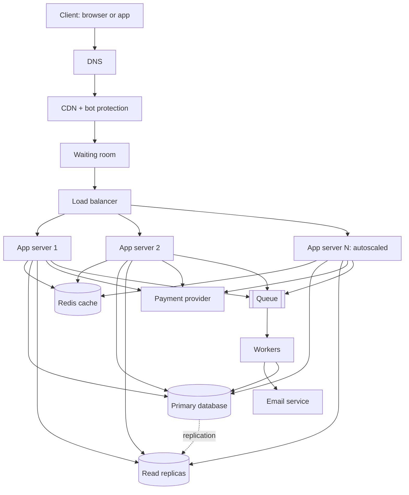

# TicketHub Design Document

TicketHub is a website that sells tickets for concerts and events. This document follows the six-part framework: requirements, estimates, API, data model, architecture, and trade-offs. It also explains how the design prevents two people from buying the same seat.

## 1. Requirements

### Functional
- Users can register, log in and log out.
- Users can browse and search events.
- Users can view the seat map of an event, with each seat's price and status (available, held, sold).
- Users can hold seats for a short time (10 minutes) while they pay.
- Users can pay for held seats and receive a confirmation.
- Users can view their tickets.
- Users receive a confirmation email.

### Non-functional
- **Correctness (most important):** one seat is never sold to two people, and nobody is charged for a seat they do not get.
- **Speed:** browsing pages load in under 1 second; holding a seat responds in under 500 ms, even during a big sale.
- **Fairness:** during a big sale, people get a chance in the order they arrived, and bots or refreshing do not give an advantage.
- **Availability:** 99.9% uptime; the site must stay up during a big sale (a crash on sale day is the worst outcome).
- **Scalability:** handle traffic about 500 times higher than normal for short periods.
- **Security:** HTTPS, hashed passwords, and card details handled only by the payment provider.
- **Durability:** a paid order is never lost.

## 2. Estimates

### Normal day
| Metric | Calculation | Result |
|--------|-------------|--------|
| Page views per day | 50,000 visitors × 10 pages | 500,000 |
| Page views per second | 500,000 ÷ 86,400 | ~6 average, ~30 peak (5× average) |
| Tickets sold per day | given | 5,000 |
| Purchases per second | 5,000 ÷ 86,400 | ~0.06 average, under 1 at peak |
| Storage per year | 5,000 × 365 × ~1 KB | ~1.8 GB |

### Big sale (200,000 people, 20,000 seats, first 10 minutes = 600 seconds)
Assumptions: each person loads the event and seat pages about 10 times and makes about 3 hold attempts.

| Metric | Calculation | Result |
|--------|-------------|--------|
| Page and seat-map requests | 200,000 × 10 ÷ 600 | ~3,300 per second average, ~17,000 peak in the first minute |
| Hold attempts | 200,000 × 3 ÷ 600 | ~1,000 per second average, ~5,000 peak |
| Successful purchases | 20,000 ÷ 600 | ~33 per second |
| People who get a ticket | 20,000 ÷ 200,000 | 10% (so 90% leave disappointed) |

### Comparison
| | Normal day | Big sale | Difference |
|---|-----------|----------|-----------|
| Reads per second (average) | ~6 | ~3,300 | **~550× higher** |
| Purchases per second | ~0.06 | ~33 | **~550× higher** |
| Peak reads per second | ~30 | ~17,000 | **~570× higher** |

The big sale is a short, extreme spike, not steady growth. Sizing the whole system for it all year would waste money, so the design uses a waiting room, caching and autoscaling to handle it. Also, only 10% of people succeed, so most hold attempts are expected to fail and must fail quickly and cheaply.

## 3. API

Base path `/api/v1`. All requests except browsing need `Authorization: Bearer <token>`.

| Method | Path | Description | Success |
|--------|------|-------------|---------|
| GET | `/events?query=&date=&limit=&cursor=` | Browse and search events | 200 |
| GET | `/events/{eventId}` | Event details | 200 |
| GET | `/events/{eventId}/seats` | Seat map with status and price | 200 |
| POST | `/events/{eventId}/queue` | Join the waiting room (big sales), returns an admission token | 202 |
| POST | `/holds` | Hold seats for 10 minutes | 201 |
| DELETE | `/holds/{holdId}` | Release a hold early | 204 |
| POST | `/orders` | Pay for a hold and create the order | 201 |
| GET | `/me/tickets` | List my tickets | 200 |

### Example: hold seats
`POST /api/v1/holds`

```json
{ "eventId": 42, "seatIds": [1301, 1302] }
```

Response `201 Created`:

```json
{
  "holdId": "h_7c91",
  "seatIds": [1301, 1302],
  "expiresAt": "2026-11-01T18:10:00Z",
  "totalCents": 24000
}
```

### Example: pay
`POST /api/v1/orders` with header `Idempotency-Key: 9f1c...` (so a double-click or retry never charges twice)

```json
{ "holdId": "h_7c91", "paymentToken": "tok_visa_abc" }
```

Response `201 Created`:

```json
{ "orderId": 5530, "status": "paid", "seatIds": [1301, 1302] }
```

### Errors
| Status | When |
|--------|------|
| 400 | Invalid request (e.g. more than 6 seats) |
| 401 | Not logged in |
| 402 | Payment failed |
| 403 | Not admitted from the waiting room yet |
| 404 | Event or hold not found |
| 409 | **Seat already taken or held by someone else** |
| 410 | Hold expired |
| 429 | Too many requests |
| 500 / 503 | Server problem or temporarily overloaded |

## 4. Data model

```sql
CREATE TABLE users (
  id            BIGINT GENERATED ALWAYS AS IDENTITY PRIMARY KEY,
  email         VARCHAR(255) NOT NULL UNIQUE,
  password_hash VARCHAR(255) NOT NULL,
  name          VARCHAR(100) NOT NULL,
  created_at    TIMESTAMPTZ  NOT NULL DEFAULT now()
);

CREATE TABLE events (
  id         BIGINT GENERATED ALWAYS AS IDENTITY PRIMARY KEY,
  name       VARCHAR(200) NOT NULL,
  venue      VARCHAR(200) NOT NULL,
  starts_at  TIMESTAMPTZ  NOT NULL,
  on_sale_at TIMESTAMPTZ  NOT NULL
);

CREATE TABLE seats (
  id              BIGINT GENERATED ALWAYS AS IDENTITY PRIMARY KEY,
  event_id        BIGINT NOT NULL REFERENCES events(id),
  section         VARCHAR(20) NOT NULL,
  row_label       VARCHAR(10) NOT NULL,
  seat_number     INT NOT NULL,
  price_cents     INT NOT NULL CHECK (price_cents >= 0),
  status          VARCHAR(10) NOT NULL DEFAULT 'available'
                  CHECK (status IN ('available', 'held', 'sold')),
  held_by         BIGINT REFERENCES users(id),
  hold_expires_at TIMESTAMPTZ,
  UNIQUE (event_id, section, row_label, seat_number)
);

CREATE TABLE orders (
  id               BIGINT GENERATED ALWAYS AS IDENTITY PRIMARY KEY,
  user_id          BIGINT NOT NULL REFERENCES users(id),
  event_id         BIGINT NOT NULL REFERENCES events(id),
  total_cents      INT NOT NULL,
  status           VARCHAR(10) NOT NULL CHECK (status IN ('paid', 'refunded')),
  idempotency_key  VARCHAR(64) NOT NULL UNIQUE,
  payment_ref      VARCHAR(100) NOT NULL,
  created_at       TIMESTAMPTZ NOT NULL DEFAULT now()
);

CREATE TABLE order_items (
  order_id BIGINT NOT NULL REFERENCES orders(id),
  seat_id  BIGINT NOT NULL UNIQUE REFERENCES seats(id),  -- a seat can be in at most ONE order
  PRIMARY KEY (order_id, seat_id)
);

CREATE INDEX idx_seats_event_status ON seats (event_id, status);
CREATE INDEX idx_orders_user ON orders (user_id, created_at DESC);
```

### Relationships
- **users → orders:** one-to-many (a user places many orders).
- **events → seats:** one-to-many (an event has thousands of seats).
- **events → orders:** one-to-many.
- **orders ↔ seats:** many-to-many through `order_items`. In practice each seat appears in at most one order, which the `UNIQUE (seat_id)` constraint enforces.
- **users → seats (`held_by`):** one-to-many, a user may currently hold several seats.

## 5. How the design prevents double-booking

Two layers protect each seat: an **atomic conditional update** (stops the race) and a **database constraint** (guarantees it even if the code has a bug).

**Step 1 – Hold (atomic update).** The wrong way is to run `SELECT` ("is the seat free?") and then `UPDATE`, because another request can slip in between. Instead, check and claim in one statement:

```sql
UPDATE seats
SET status = 'held', held_by = :userId, hold_expires_at = now() + interval '10 minutes'
WHERE id = :seatId
  AND (status = 'available'
       OR (status = 'held' AND hold_expires_at < now()));
```

If the statement changes **1 row**, the user got the seat. If it changes **0 rows**, someone else got there first and the API returns `409 Conflict`. When two users click at the same instant, the database locks the row for the first one; the second waits, then re-checks the `WHERE` condition, sees the seat is held and updates nothing. Holds for several seats run in one transaction (seats locked in ID order to avoid deadlocks), so either all seats are held or none are.

**Step 2 – Pay (transaction).** In one transaction we: confirm the seats are still held by this user and the hold has not expired, take payment (idempotency key prevents double charges), insert the order and `order_items`, set the seats to `sold`, and commit. If anything fails, the transaction rolls back and nothing is half-saved.

**Step 3 – Constraint safety net.** `order_items.seat_id` is `UNIQUE`, so even if a bug let two orders try to claim the same seat, the database would reject the second insert and roll that transaction back. `CHECK` constraints keep `status` valid.

**Step 4 – Expiry.** A worker releases expired holds every minute (`status='available'`), and the hold query above also treats expired holds as available, so abandoned seats return to sale.

**Example:** Ana and Ben both click seat 1301 at the same moment. Both run the `UPDATE`. The database processes one first (say Ana: 1 row changed → hold granted); Ben's update then finds `status = 'held'` and changes 0 rows → he gets `409 Seat already taken` and picks another seat. Only one of them can ever pay for it.

## 6. Architecture



### Components
- **Client:** the browser or app where people browse events, pick seats and pay.
- **DNS:** maps `tickethub.com` to our CDN so we can change servers without users noticing.
- **CDN and bot protection:** serves images, scripts and event pages from locations near the user and blocks obvious bots, so most traffic never reaches our servers.
- **Waiting room:** during a big sale, lets people in at a controlled rate (for example 2,000 at a time) in order of arrival, so 200,000 people do not hit the booking system at once and the sale is fair.
- **Load balancer:** spreads requests across app servers and skips unhealthy ones.
- **App servers (autoscaled):** stateless servers that run the API; we add more before and during a sale.
- **Redis cache:** holds event pages, the seat map (refreshed every 1–2 seconds) and waiting-room tokens, so most reads never touch the database.
- **Primary database:** the single source of truth; all holds, orders and payments are written here, where row locks and constraints prevent double-booking.
- **Read replicas:** serve browsing and search queries so reads never slow down seat holds.
- **Payment provider:** handles card details and charges, so we never store card numbers.
- **Queue and workers:** take slow jobs (confirmation emails, ticket PDFs, releasing expired holds) off the purchase path, so paying stays fast.

### How it survives the big sale
1. **Before the sale:** event pages are cached on the CDN and extra app servers are started in advance.
2. **At the sale:** 200,000 arrivals enter the waiting room, which admits only as many as the booking system can handle (about 33 purchases per second is easy for one primary database).
3. **Seat map reads** (the biggest load, ~3,300–17,000 per second) are answered by CDN and Redis. A slightly out-of-date map is safe because the hold step is the real check.
4. **Holds and payments** (the correctness-critical part) go to the primary database, where row-level locks make each seat a separate, quick conflict, so thousands of users fighting over different seats do not block each other.
5. **Per-user rate limits** and a limit of 6 seats per order stop bots and hoarding.
6. **Slow work** goes through the queue, and if the email service is slow, tickets still sell.
7. **Failure handling:** a read replica can be promoted if the primary fails, the cache falling over just means more database reads, and 429/503 responses with "try again" messages protect the system under overload.

## 7. Trade-offs

1. **Fairness and stability vs convenience (waiting room).** The waiting room protects the database and gives everyone a fair turn, but people must wait, and some will be annoyed. Without it, the site would probably crash and the fastest bots would win.
2. **Speed (cache) vs freshness.** Caching the seat map for 1–2 seconds removes thousands of database reads per second, but a user may click a seat that was just taken and see a `409` error. We accept that because the hold step is always checked on the primary database, so correctness is never at risk, only occasional disappointment.
3. **Strong consistency vs scalability.** Seat holds always go to one primary database, which keeps double-booking impossible but limits write capacity. At 5,000 holds per second this is fine; if TicketHub grows, we would shard by `event_id` (each event's seats live on one shard), so seat checks stay on a single database.
4. **Hold time: short vs long.** A 10-minute hold gives people time to pay, but every held seat is unavailable to others. A shorter hold (for example 5 minutes) sells seats faster in a big sale but is stressful for buyers. We choose 10 minutes normally, and could shorten it for very popular events.
5. **Queue for background jobs vs immediate results.** Emails and PDFs may arrive a few seconds late, but purchases stay fast and the system keeps working if the email service slows down.
